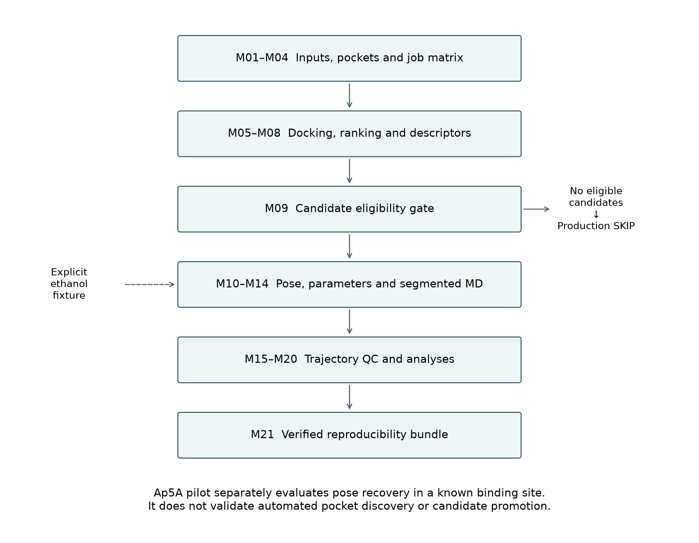
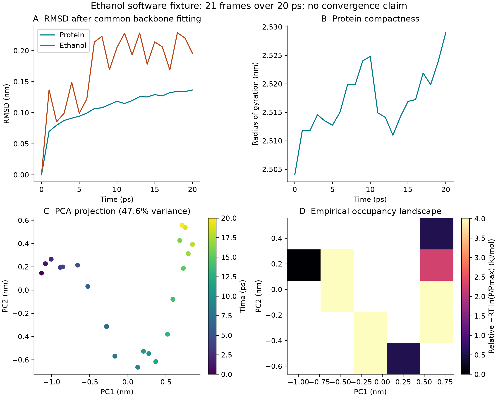
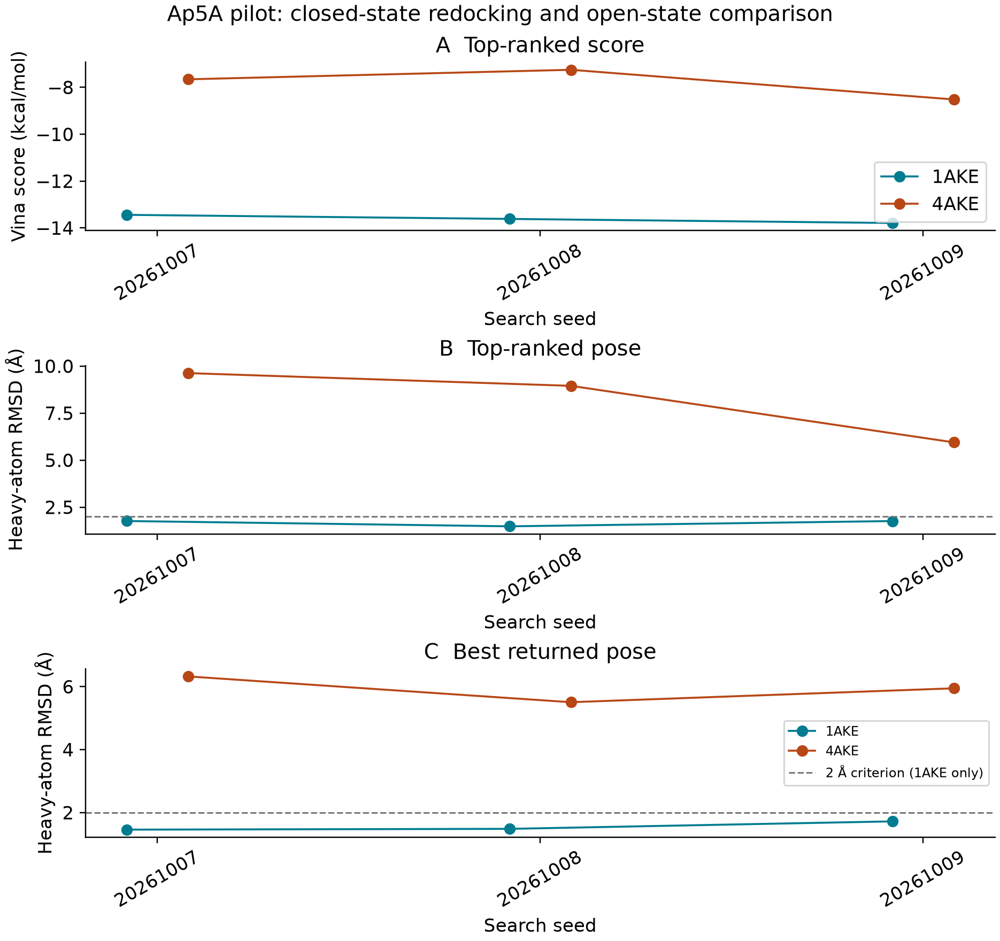
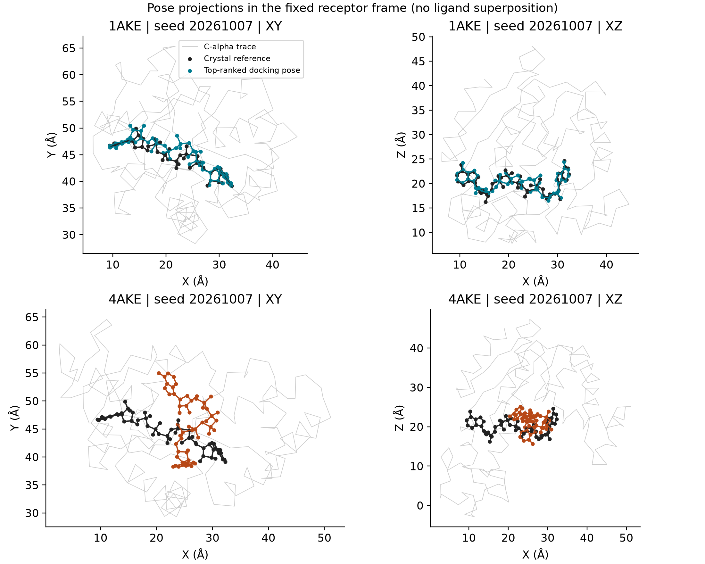
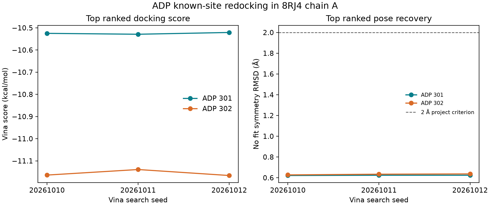
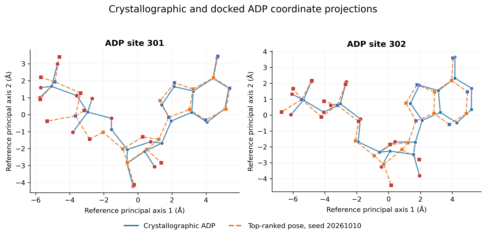
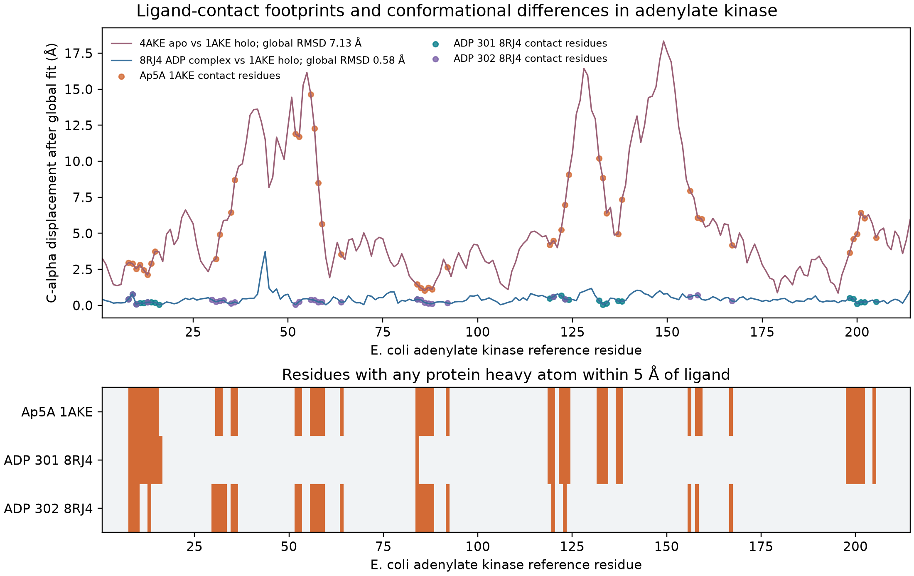
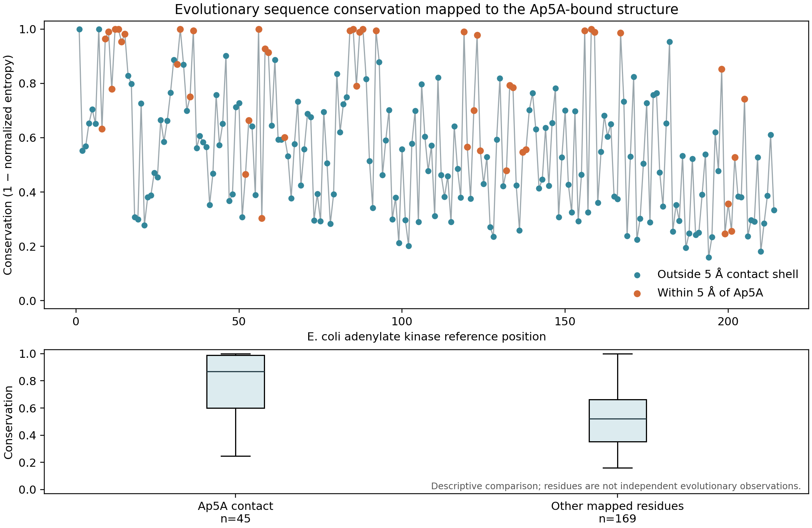
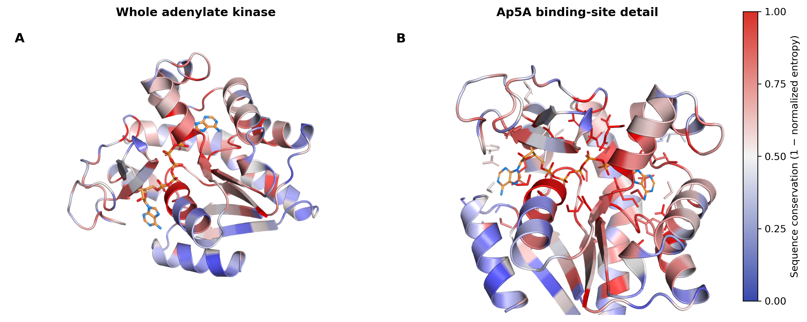

# PocketToDynamics A Reproducible Screening and Molecular Dynamics Workflow With an Evolutionary Conservation Companion

**Article type:** Technology and Code

**Authors:** Juan Philippe Teixeira¹, Daniel Ferreira de Lima Neto¹, Rosiléia Marinho de Quadros², Miklos Maximiliano Bajay¹

**Affiliations:**

¹ State University of Santa Catarina – Center for Agricultural and Veterinary Sciences – Graduate Program in Biochemistry and Molecular Biology (PMBqBM)

² State University of Santa Catarina – Center of Agroveterinary Sciences – Department of Veterinary Medicine

## Abstract

PocketToDynamics is a modular computational workflow that connects pocket mapping and virtual screening to molecular dynamics (MD), structural analysis, endpoint energetic estimation, and empirical conformational landscapes. An optional sequence-to-structure analysis projects evolutionary conservation from reviewed bacterial adenylate-kinase sequences onto the Ap5A contact site. Its principal contribution is an explicit chain of job manifests, quality-control checks, and artifact provenance across otherwise separate computational tools. The implementation contains 25 executable entries spanning M01–M21, including screening preparation and dynamics-entry submodules. A candidate gate separates screening eligibility from downstream execution, while a deliberately selected fixture permits testing MD and analysis without representing a rejected ligand as a promoted scientific candidate. A recorded end-to-end audit using an adenylate-kinase/ethanol fixture reported 24 passing entries and one expected skip; the ordinary production route reported 12 passing entries and 13 skips because no candidate met the gate. The fixture included 20 ps each of NVT and NPT equilibration, 20 ps of segmented production, and 21 trajectory frames. Downstream checks covered structural metrics, three-frame MM/GBSA, principal component analysis, occupancy-derived landscapes, interaction persistence, and a hash-verified reproducibility archive. Known-site redocking recovered the crystallographic Ap5A pose in 1AKE in all three searches (top-ranked RMSD 1.48–1.76 Å). A second pilot used ADP in two crystallographic sites of 8RJ4: six of six top-ranked poses were within 0.64 Å of their site-specific references. The 8RJ4 chain-A sequence is identical to 1AKE, so this adds two ligand sites and a second ligand chemistry, not an independent target. These observations establish software integration, data consistency and narrowly scoped pose recovery, not binding affinity, conformational convergence or biological activity. A reference-guided analysis of 405 unique adenylate-kinase sequences mapped 214 reference positions to 1AKE; the 45 residues within 5 Å of Ap5A had mean conservation 0.788, compared with 0.517 among 169 other mapped residues. This descriptive, unweighted comparison is not a phylogeny-aware test or evidence of affinity. The workflow makes computational decisions and limitations inspectable while leaving scientific validation across realistic systems and longer simulations for future work.

**Keywords:** evolutionary bioinformatics; sequence conservation; structure mapping; virtual screening; binding pockets; molecular dynamics; reproducibility; provenance.

## Introduction

A structure-based screening workflow involves more than generating docking scores. Pocket definitions must be connected to docking boxes, selected poses must preserve molecular identity when converted between formats, and parameterized systems must remain traceable through simulation and analysis. Each transition can introduce differences in atom ordering, chemical representation, reference coordinates, units, or sampling. A usable computational record must therefore describe both the numerical outputs and the decisions that produced them.

PocketToDynamics addresses these transitions through a sequence of independently inspectable Python modules coordinated by a common runner. It combines pocket-oriented docking with candidate selection, AMBER-based parameterization, GROMACS simulation [1], and trajectory analyses. The implementation emphasizes explicit failure states, artifact checksums, recorded commands, and separation between production eligibility and software fixtures. Docking and endpoint energetics are used as computational descriptors; neither is treated as an experimental affinity measurement.

This manuscript describes the inspected implementation, its recorded fixture validation, a separate known-site Ap5A docking pilot, and an optional evolutionary conservation analysis that links a curated enzyme-sequence set to structure-defined ligand contacts. It does not report a screening campaign, a discovered ligand, an experimentally validated interaction, or a converged free-energy calculation. Earlier development descriptions ended at M14 with M15 under development. The repository inspected for this manuscript supersedes that milestone: M15–M21 contain executable implementations and recorded fixture checks. Their presence is distinguished below from the substantially broader scientific validation that remains outstanding.

Integrated molecular-simulation platforms already connect preparation and dynamics through reusable graphical or notebook workflows, including Galaxy-based molecular-dynamics workflows and Enlighten2 [2–3]. PocketToDynamics occupies a different implementation niche: a local, manifest-driven command-line chain that also carries pocket-screening decisions into MD entry, trajectory analysis and hash-verified packaging. It is not a new docking engine, workflow language, free-energy method or evolutionary predictor, and we do not claim superior usability or performance. Evolutionary conservation has already been used for binding-site prediction; ConCavity combines conservation estimates with structure-based cavity evidence [4]. PocketToDynamics instead maps an auditable sequence profile after site definition and does not use it to discover pockets or rank ligands. Its contribution is the inspectable connection among screening eligibility, downstream molecular simulation and data provenance, with a companion sequence-to-structure report.

## Software Architecture and Workflow

The repository separates configuration, inputs, scripts, tests, manifests, logs, intermediate work, and results. Heavy simulation artifacts reside outside the source repository in configured dynamics directories. A canonical registry, `scripts/p2d_steps.py`, defines module order for both orchestration and status reporting. M05 and M10 each contain three executable entries, yielding 25 entries across M01–M21.

| Modules | Implemented responsibility | Evidence and scope |
|---|---|---|
| M01–M04 | Project initialization, input normalization, pocket mapping, deterministic job matrix | Recorded fixture and production-route passes |
| M05A–M05C | Engine preflight, input preparation, docking execution and provenance-aware reuse | Recorded docking fixture; not a comparative engine benchmark |
| M06–M09 | Score parsing, ranking, chemical descriptors, candidate gate | Recorded rejection of the ethanol fixture |
| M10A–M10C | Dynamics jobs, dependency preflight, selected-pose extraction | M10A expected skip; explicit fixture enters at M10C |
| M11–M14 | Parameterization, solvent/minimization, equilibration, segmented production | Recorded short computational fixture |
| M15 | Trajectory reconstruction, periodic-boundary processing and fitting | Implemented; recorded 21-frame fixture and subsequent artifact recheck |
| M16 | Structural metrics and protein–ligand contacts | Implemented; fixture and numerical checks |
| M17 | Single-trajectory MM/GBSA and residue decomposition | Implemented; three selected fixture frames |
| M18 | Cartesian C-alpha principal component analysis (PCA) | Implemented; covariance and reconstruction checks |
| M19 | PC1/PC2 occupancy landscape and representative structures | Implemented; discrete histogram checks |
| M20 | Per-residue contact and hydrogen-bond occupancy | Implemented; matrix/occupancy consistency checks |
| M21 | Inventory, source/environment snapshots, figures, tables and verified archive | Implemented; archive integrity checks |
| Companion analysis | Optional sequence conservation profile mapped to structural ligand contacts | 405 unique reviewed bacterial enzyme sequences; descriptive single-site analysis; not used to change docking rank |



*Figure 1. Logical workflow. The explicit fixture enters at M10C and does not change candidate eligibility. Each stage retains its own checks and provenance.*

The production and fixture routes have separate status tables and downstream output directories. `PASS` denotes satisfaction of module-specific software checks, whereas `SKIP` denotes absence of eligible upstream work. Neither status independently establishes scientific validity. The runner stops on nonzero exits or failed checks, initializes unexecuted entries as `NOT_RUN`, and records commands, durations, exit codes, and log hashes. Missing logs are represented as `UNKNOWN` rather than silently omitted.

The fixture is intentionally exceptional: the runner verifies the committed test input identities, exercises ordinary screening through M10B, and explicitly supplies the recorded ethanol pose at M10C. It does not reduce screening thresholds or relabel the ligand as a successful screening candidate. This permits downstream integration testing while retaining the meaning of the production gate.

## Methods

### Input preparation and pocket mapping

Input normalization and hashing establish identifiable receptor and ligand representations. M03 invokes ConCavity [4] and selects residues with scores of at least 0.10. Selected residues are connected when their C-alpha coordinates are within 8 Å; connected components containing at least three residues become pocket records. Components are ordered by summed score and then size. The arithmetic centroid of their C-alpha coordinates provides the pocket center. These are implementation thresholds, not experimentally calibrated definitions of ligandability.

M04 enumerates receptor–pocket–ligand combinations deterministically. Screening configuration specifies a 20 × 20 × 20 Å box and Vina as the default engine. The configured Vina settings are exhaustiveness 8, up to nine modes, an energy range of 4 kcal/mol, and seed 20261007. Meeko is the preferred preparation backend, with Open Babel available as a fallback. GNINA appears in engine configuration and preflight support, but the present evidence does not establish equivalent validation across engines. The Vina method is described by Eberhardt et al. [5]. Meeko prepares docking inputs, with Open Babel configured as a fallback [6–7]; molecular descriptors are calculated with RDKit [8].

Docking reuse requires agreement of inputs, docking box and parameters, task identity, executable contents/version, and the stored output-pose hash. Prior attempts are retained. This guards against accepting an old pose merely because an output file exists; it does not guarantee identical numerical results across arbitrary hardware and software environments.

### Additional known-site ADP redocking

A second ligand model was assessed with PDB 8RJ4, an E. coli adenylate-kinase product-state complex containing two crystallographic ADP molecules and Mg²⁺ [9–10]. Chain A was used; its 214-residue sequence matches chain A of 1AKE exactly. For each ADP site (residues 301 and 302), a new starting conformation was generated independently from the Chemical Component Dictionary graph with RDKit ETKDGv3 and UFF minimization. The crystal coordinates were reserved for the evaluation reference and to define the known-site box. The ADP charge was set to −3 by deprotonating one α- and two β-phosphate hydroxyl groups. Receptor preparation used protein ATOM records only; all HETATM records, including both ADPs, Mg²⁺, chloride and waters, were omitted. Thus the test does not evaluate metal-assisted docking or the experimentally observed Mg²⁺ coordination.

Each search box was centered on the crystallographic ADP heavy-atom bounds with 6 Å added per side and a minimum dimension of 20 Å. Vina 1.2.5 was run with exhaustiveness 16, nine modes, energy range 4 kcal/mol, and three deterministic seeds (20261010–20261012) per site. Pose RMSD was symmetry-aware, no-fit heavy-atom RMSD to the corresponding crystal ligand; top-ranked recovery at ≤2.0 Å was the prespecified criterion. The analysis therefore tests local known-site redocking, not blind pocket discovery. Input structures, preparation records, hashes, logs and all 54 poses are provided under `docs/validation/adk_multi/`.

### Ranking and candidate eligibility

M06 extracts pose scores. M07 groups task-level best scores by receptor and ligand across mapped pockets, reporting the best, mean, median, standard deviation, worst score, hit fraction, and a gap between the two best pocket scores where available. Its integrated score combines dense ranks for best score, mean score, hit fraction, and score standard deviation, with equal configured weights. Score dispersion is a ranking heuristic across pockets; it is not replicate-based statistical uncertainty.

M08 calculates RDKit molecular descriptors and docking-derived ligand efficiency. The configured M09 gate requires all four conditions: integrated rank no greater than 20, best docking score no greater than −7.0 kcal/mol, hit fraction at least 0.25, and docking ligand efficiency at least 0.20. Numeric-domain checks reject nonfinite values, fractional ranks, and out-of-range fractions. The gate does not promote failed candidates. The thresholds describe the current configuration and have not been validated as predictors of affinity or biological response.

### Selected-pose reconstruction and parameterization

M10 prepares dynamics job records, checks dependencies, and extracts the selected pose. Chemical identity is restored using the normalized SDF as the ligand reference while transferring docked heavy-atom coordinates. This addresses the loss of a chemically complete hydrogen representation in the docking PDBQT route. In the ethanol fixture, the resulting ligand has formula C2H6O and nine atoms.

M11 uses AmberTools `antechamber`, `parmchk2`, and `tleap`, with ff19SB for protein, GAFF2 for ligand, and AM1-BCC charges [11–13]. ParmEd [14] converts the resulting system to GROMACS representation. The configured solvent is TIP3P [15]; this is the repository's tested configuration and should not be interpreted as a claim that it is the preferred solvent pairing for ff19SB. Crystallographic waters are stripped according to the configured residue-name policy. Consequently, the workflow does not currently establish retention of functionally essential crystallographic waters as a general preparation strategy.

### System setup and simulation

M12 configures an octahedral TIP3P solvent box with a 12 Å buffer and neutralizes the system with sodium or chloride ions as required. Neutralization is distinct from prescribing a bulk electrolyte concentration. Steepest-descent minimization is configured for at most 5,000 steps, a 0.01 nm step size, and a force threshold of 1,000 kJ mol−1 nm−1. The configuration uses a Verlet cutoff scheme, particle-mesh Ewald electrostatics, and 1.0 nm real-space electrostatic and van der Waals cutoffs.

M13 performs 20 ps NVT and 20 ps NPT equilibration at 300 K and, for NPT, 1 bar. The timestep is 0.002 ps, hydrogen-involving bonds are constrained, and temperature and pressure coupling use V-rescale and C-rescale. These short configured stages are fixture-scale execution evidence; their adequacy for a new molecular system requires independent assessment.

M14 implements segmented production with checkpoint recovery. The ordinary production configuration specifies 100,000 ps total and 10,000 ps segments; these settings must not be confused with completed sampling. The fixture overrides them to 20 ps total in two 10 ps segments and writes coordinates every 1 ps. Reuse verifies source coordinates, checkpoint/topology provenance, configuration, executable signature, and completed-segment hashes. Legacy checkpoints without the required provenance are rejected.

### Trajectory preprocessing and structural analysis

M15 generates whole, no-jump, centered, and backbone-fitted trajectory representations. It checks ordered segment intervals, hashes, atom counts, frame times, coordinates, boxes, and coverage. The ligand and protein are centered together, and the whole system is retained. MDAnalysis [16–17] reads GRO/XTC rather than the installed GROMACS TPR format, which is documented as unsupported by the installed MDAnalysis parser.

M16 computes protein and ligand root-mean-square deviation relative to the first frame after a common backbone fit. The ligand is not independently fitted. C-alpha root-mean-square fluctuation is measured about each atom's mean fitted position. Protein radius of gyration and solvent-accessible surface area are also reported. Heavy-atom contacts use a 0.45 nm cutoff and minimum-image distances on the unrotated centered trajectory. Protein–ligand hydrogen bonds are calculated with GROMACS `hbond-legacy` using a 0.35 nm donor–acceptor distance and a 30° deviation-from-linear angular cutoff. Metric timestamps must match the trajectory frames. Structural distances use nm, times ps, and surface areas nm².

### Endpoint energetic estimates

M17 uses AmberTools `ante-MMPBSA.py` and `MMPBSA.py` [18] for single-trajectory MM/GBSA with `igb=5`, `mbondi2` radii, and the configured implicit-solvent salt concentration of 0.15 M. The implementation verifies Amber/GROMACS topology correspondence and atom identity before stripping solvent and ions. A rigid translation places the ligand in the nearest periodic image relative to the receptor, and an explicit frame ledger records selected frames and shifts.

The fixture selects frames 0, 10, and 20, corresponding to 0, 10, and 20 ps. Outputs include energy terms, residue decomposition, and the total endpoint estimate in kcal/mol. No entropy contribution is calculated. The reported ordinary standard error does not account for serial correlation and is not evidence of convergence. Numerical estimates are intentionally not presented as biological results in this manuscript.

### Essential dynamics and empirical landscape

M18 performs unweighted Cartesian PCA on C-alpha coordinates from the common fitted trajectory. Coordinates are expressed in nm and centered about the sample mean. Singular-value decomposition yields eigenvalues using the N−1 covariance normalization; near-null singular modes are removed. Checks include reconstruction, orthogonality, mean-centered projections, and consistency of total projected variance. Configured frame limits are enforced explicitly instead of silently reducing the sample.

M19 bins the first two principal-component projections into an equal-width two-dimensional histogram: five bins per axis for the fixture and 30 for the ordinary configuration. For occupied bins, the reported relative landscape is

\[
F_i=-RT\ln(P_i/P_{\max}),
\]

where temperature is taken from the production manifest and R = 0.008314462618 kJ mol−1 K−1. Unsampled bins have infinite energy; no pseudocount is added. A deterministic eight-neighbor density-ascent procedure assigns discrete basins, retaining every basin. Representative frames are selected by proximity to the corresponding peak-bin center in PC1/PC2 space. This is an occupancy transformation of the sampled projection, not a demonstrated equilibrium free-energy surface or a validated kinetic-state model.

### Interaction persistence and packaging

M20 calculates per-residue heavy-atom contact occupancy as the fraction of sampled frames with a contact. Hydrogen bonds use topology-derived donor–hydrogen bonds and MDAnalysis charge-based hydrogen/acceptor heuristics, with a donor–acceptor cutoff of 3.5 Å and a donor–hydrogen–acceptor angle greater than 150°. This definition is recorded separately from the M16 GROMACS convention; identical counts are not assumed. Residues are ranked by contact occupancy and then hydrogen-bond occupancy. Persistence denotes sampled-frame frequency, not residence time.

M21 assembles source snapshots, configuration, inputs, simulation artifacts, environment descriptions, commands, figures, and tables into an archive with an inventory and SHA-256 hashes. Archive members are read back and verified after compression, and a verification script supports checking the extracted bundle. External binaries and complete Conda environments are described rather than embedded. The source Git repository and the heavy reproducibility bundle are separate distribution objects.

### Evolutionary sequence data and site mapping

A companion analysis was added to connect sequence evolution with a structure-defined binding site. UniProtKB [19] was queried on 9 October 2026 for reviewed bacterial entries annotated EC 2.7.4.3 and lengths of 190–230 residues. The query returned 588 records. One record per species was selected by minimum absolute length difference from the 214-residue E. coli K-12 reference P69441, with accession as a deterministic tie-break; identical sequences were then removed, leaving 405 sequences. This enzyme annotation and length filter define a practical family set; orthology was not independently established.

Each sequence was aligned globally to P69441 using Biopython PairwiseAligner [20–21] with BLOSUM62 [20], gap-open −10, and gap-extension −0.5. Sequences were retained at reference coverage ≥75% and identity ≥25% across paired non-gap positions. Insertions were represented in a reference-anchored alignment. The resulting matrix contained 405 sequences and 610 columns; all 214 reference positions were mapped. This simple reproducible alignment is not a replacement for a curated profile or phylogeny-aware multiple-sequence alignment.

For each alignment column, Shannon entropy was calculated from the 20 standard amino acids after excluding gaps, and divided by log₂(20). Conservation was defined as one minus normalized entropy; gap coverage was reported separately. Reference positions were mapped to chain A of 1AKE using a global pairwise sequence alignment. Ap5A-contact residues were defined as having any receptor heavy atom within 5 Å of a ligand heavy atom in the crystallographic reference structure. The contact and noncontact means are descriptive; no phylogenetic weighting, tree model, correction for dependence among positions, hypothesis test, or affinity inference was applied. This optional script does not alter pocket detection or docking ranks.

### Known-site Ap5A docking pilot

A separate pilot used the co-crystallized Ap5A inhibitor (CCD AP5) in 1AKE [22] as a pose reference and the unligated 4AKE structure [23] as an open-state comparison. Chain A was selected from each entry, with blank/A alternative conformers and all receptor heteroatoms removed. The CCD chemical graph was assigned an explicit −5 charge by removing one terminal phosphate hydroxyl proton per phosphorus; this is a modeling assumption, not a validated protonation ensemble. The eight carbon stereocenters were checked against the CCD. An independent ETKDGv3 conformer, generated with seed 20261008 and relaxed using UFF, supplied the docking start instead of the crystal conformation. Meeko 0.8.0 prepared the receptors and ligand.

The 4AKE receptor was aligned to 1AKE using 214 matched chain-A C-alpha atoms. Their global C-alpha RMSD was 7.131 Å; consequently, ligand RMSD for 4AKE is alignment-dependent and descriptive. The common known-site box was centered at (20.8655, 44.5385, 20.4265) Å with dimensions (34.889, 22.777, 20.399) Å, obtained from the crystallographic ligand bounds plus 6 Å per side and a minimum dimension of 20 Å. This pilot tests a known binding site rather than M03 pocket discovery or M09 candidate promotion.

Vina 1.2.5 ran three searches per receptor with seeds 20261007, 20261008 and 20261009, exhaustiveness 8, at most nine returned modes and a 4 kcal/mol energy range. Each search used two CPU threads. The project criterion for 1AKE recovery was a 57-heavy-atom RMSD no greater than 2 Å in the receptor frame, reported both for the top-ranked pose and the closest returned pose. Graph matching preserved carbon stereochemistry and treated terminal phosphate oxygens as resonance-equivalent, enumerating 64 equivalent mappings. No ligand superposition was performed. Metric checks required zero RMSD for identical coordinates and phosphate-oxygen swaps, a retained 10 Å rigid translation, and rejection of an inverted carbon stereocenter. No binary recovery criterion was applied to 4AKE, which lacks an experimental Ap5A pose. Search seeds represent algorithmic repeats, not independent biological or MD replicates.

## Validation and Testing

Evidence has three levels: source inspection establishes implementation; saved manifests, logs, and artifacts establish recorded execution; regression and numerical checks establish selected invariants. None alone establishes scientific predictive performance. The recorded audit is documented in `docs/AUDIT_2026-10-08.md`, the two status tables, and the production/fixture audit manifests.

The ordinary route with test inputs passed screening and candidate evaluation but promoted no ligand. Dynamics stages dependent on a promoted job therefore skipped. The explicit fixture continued from its controlled pose and exercised parameterization through archive construction. During the recorded audit, M17 initially encountered an Amber topology-overwrite failure. The implementation was corrected, the prior attempt retained, and the audit resumed after checking upstream records. This history demonstrates a recorded recovery path rather than an uninterrupted first-attempt execution.

Negative regression checks cover altered hashes, incompatible docking reuse, malformed manifests, nonfinite candidate values, invalid ranks/fractions, corrupted production outputs, and trajectory gaps. M14 also has checkpoint-resume integration checks. Module-level tests verify dimensions, units and ranges where applicable, initial RMSD, selected energetic frames, PCA invariants, landscape frame accounting, occupancy consistency, and bundle inventory contents.

During publication preparation, the core integrity and pipeline-failure regression suites passed again. Read-only checks of existing M15–M21 artifacts also passed. These checks did not regenerate trajectories or repeat the full computational audit. They therefore provide fresh verification of selected existing artifacts, not a new independent MD replicate or a new end-to-end run.

## Results of Fixture Validation and the Ap5A and ADP Pilots

### End-to-end fixture execution

The receptor fixture identifies adenylate kinase as PDB entry 4AKE and contains two 214-residue chains. Ethanol is a small integration-test ligand. Its use does not imply known or predicted specific binding to adenylate kinase.

| Check | Recorded observation | Interpretation |
|---|---|---|
| Production-route status | 12 PASS, 13 SKIP | Correct downstream abstention after candidate rejection |
| Explicit fixture status | 24 PASS, 1 SKIP | M10A remained an expected skip; controlled M10C entry exercised downstream software |
| Ligand reconstruction | C2H6O; nine atoms | Chemical representation preserved for this fixture |
| Solvated system | 64,587 atoms; reported residual charge below 10−6 elementary-charge units | Setup and charge consistency for one system |
| Minimization | Recorded convergence | Numerical minimization criterion satisfied |
| Equilibration | 20 ps NVT and 20 ps NPT | Short execution and configured QC completed |
| Production | 20 ps in two segments | Segmentation, completion detection and checkpoint recovery exercised |
| Preprocessed trajectory | 21 frames; 0–20 ps; 1 ps spacing | Expected frame/coverage integrity |
| Structural analysis | Initial RMSD zero; positive SASA/Rg; 428 C-alpha RMSF entries | Numerical and selection consistency |
| MM/GBSA | Three frames at 0, 10 and 20 ps; residue decomposition generated | Endpoint-estimation pipeline executed |
| PCA | 21 observations; rank 20 | Sample-limited covariance decomposition and reconstruction checks |
| Landscape | Three histogram basins; all 21 frames assigned | Complete discrete occupancy accounting |
| Interaction analysis | 21 × 428 residue-contact matrix | Frame/residue alignment and bounded occupancies |
| Reproducibility archive | Inventory and archived contents hash-verified | Integrity of the recorded package |

The rank-20 PCA is consistent with at most N−1 nonzero dimensions for 21 centered observations; it is not evidence of a 20-dimensional physical mechanism. Likewise, three histogram basins in a five-by-five grid describe the particular short sample and binning, not three established molecular states. Zero contacts or hydrogen bonds are permitted observations and are not automatically treated as software errors.

### Descriptive fixture figures

Across the existing 21-frame ethanol fixture, protein RMSD ranged from 0 to 0.137 nm and ligand RMSD from 0 to 0.229 nm after the common backbone fit. The protein radius of gyration ranged from 2.504 to 2.529 nm. PC1 and PC2 accounted for 47.57% of the sampled Cartesian variance. Ten of 25 landscape bins were occupied. These are descriptive properties of the short software fixture; they do not establish equilibration, stable binding or an equilibrium landscape.



*Figure 2. Descriptive analysis of the existing 20 ps adenylate-kinase/ethanol software fixture. A, protein and ligand RMSD after a common backbone fit. B, protein radius of gyration. C, C-alpha PCA projection colored by time. D, occupancy-derived relative energy on the configured 5 × 5 grid. White bins are unsampled and have infinite assigned relative energy; they are not interpolated. The same 21 frames underlie all panels. No new MD was performed for this figure.*

### Ap5A pose-recovery pilot

All six searches completed and returned nine poses each (54 poses in total). In 1AKE, the top-ranked pose met the project criterion of RMSD ≤2 Å for all three seeds. Top-pose RMSDs were 1.764, 1.482 and 1.762 Å; the closest returned poses had RMSDs of 1.457, 1.482 and 1.720 Å, at ranks 2, 1 and 2, respectively. Top Vina scores ranged from −13.789 to −13.441 kcal/mol. This is a successful known-site redocking result for one ligand under the specified protocol, not an estimate of general docking accuracy.

| Receptor | Seed | Top score (kcal/mol) | Top RMSD (Å) | Best RMSD (Å) | Best-pose rank |
|---|---|---|---|---|---|
| 1AKE | 20261007 | -13.441 | 1.764 | 1.457 | 2 |
| 1AKE | 20261008 | -13.615 | 1.482 | 1.482 | 1 |
| 1AKE | 20261009 | -13.789 | 1.762 | 1.720 | 2 |
| 4AKE | 20261007 | -7.658 | 9.626 | 6.324 | 9 |
| 4AKE | 20261008 | -7.252 | 8.950 | 5.505 | 3 |
| 4AKE | 20261009 | -8.517 | 5.947 | 5.947 | 1 |

In the aligned 4AKE comparison [23], top-pose RMSDs relative to the 1AKE ligand were 9.626, 8.950 and 5.947 Å, and the closest returned poses had RMSDs of 6.324, 5.505 and 5.947 Å. Top Vina scores ranged from −8.517 to −7.252 kcal/mol. These larger displacements describe the outputs in the chosen global-alignment frame; they are not proof of absent binding to the open state. The score difference is not a measured affinity difference or conformational free energy. Receptor rigidity, site placement, charge-state assumptions and the large protein conformational difference all limit interpretation. No Ap5A MD, MM/GBSA or energy landscape was generated.



*Figure 3. All six Ap5A searches. A, score of the top-ranked Vina pose. B, symmetry-aware RMSD of the top-ranked pose. C, smallest RMSD among the nine returned poses. The dashed 2 Å project criterion applies only to 1AKE redocking. The 4AKE values are descriptive distances to a reference from a different receptor conformation. Seeds are algorithmic repeats; lines are visual guides, and no statistical generalization is inferred from three searches.*



*Figure 4. XY and XZ projections of the top-ranked poses from the prespecified first seed, 20261007, for 1AKE and globally aligned 4AKE. Black denotes the 1AKE crystallographic ligand, teal the 1AKE docking pose, orange the 4AKE docking pose, and gray the corresponding C-alpha trace. No ligand superposition was applied. Both projections are shown because a single projection can obscure three-dimensional displacement. These views were not selected by the best RMSD across seeds.*

### ADP redocking in two product-state sites

All six ADP searches produced nine poses. The top-ranked poses recovered the matching crystallographic site in every run, with symmetry-aware RMSDs from 0.622 to 0.637 Å (mean 0.628 Å; sample SD 0.006 Å). Site 301 RMSDs were 0.622–0.624 Å and site 302 RMSDs were 0.628–0.637 Å. The top-ranked pose was also the lowest-RMSD returned pose in all six runs. This close recovery is consistent with a favorable local redocking setup; it does not measure prospective success because both box centers were derived from the crystallographic ligands. Vina scores are reported per site as run descriptors and are not compared between ligand chemistries or interpreted as affinity.

| ADP site in 8RJ4 | Seed | Top score (kcal/mol) | Top-pose RMSD (Å) | Top pose ≤2 Å |
|---|---:|---:|---:|---|
| 301 | 20261010 | −10.525 | 0.622 | Yes |
| 301 | 20261011 | −10.529 | 0.624 | Yes |
| 301 | 20261012 | −10.521 | 0.624 | Yes |
| 302 | 20261010 | −11.164 | 0.628 | Yes |
| 302 | 20261011 | −11.139 | 0.634 | Yes |
| 302 | 20261012 | −11.166 | 0.637 | Yes |



*Figure 5. Site-specific known-pose recovery for ADP in 8RJ4 chain A. Left, top-ranked Vina score by seed; right, symmetry-aware no-fit RMSD to the corresponding crystallographic ADP. Every top pose is below the prespecified 2 Å criterion. The three seeds per site measure search-seed sensitivity and are not biological or target-level replicates.*



*Figure 6. No-fit coordinate projections of the crystallographic ADP and top-ranked pose from the first seed (20261010) for each site. Both poses are projected using principal axes derived only from the crystallographic reference coordinates; the same origin and axes are applied to both structures. Solid blue denotes the crystal ligand and dashed orange denotes the docked pose. Atom symbols use red for oxygen and blue-violet for nitrogen; carbon color follows the pose. This is a visualization of the same six-run validation summarized in Figure 5, not an additional replicate.*

A residue-level structural comparison provides context for these docking checks (Figure 7). After a single global Cα alignment over 214 matched positions, the 8RJ4 chain-A model differed from 1AKE by 0.576 Å RMSD (median per-residue displacement 0.382 Å; 95th percentile 0.948 Å), whereas the open apo 4AKE structure differed by 7.131 Å RMSD (median 4.502 Å; 95th percentile 14.563 Å). These values distinguish a near-closed product complex from the substantially more open 4AKE state; they do not quantify energetic favorability. Using a 5 Å protein-heavy-atom contact definition, Ap5A in 1AKE contacted 45 residues, ADP 301 contacted 26, and ADP 302 contacted 28. The contact-set Jaccard overlap was 0.543 for Ap5A versus ADP 301, 0.553 for Ap5A versus ADP 302, and 0.149 between the two ADP sites. These are descriptive residue-set comparisons; ligand sizes differ and no inferential test was performed.



*Figure 7. Upper panel: per-residue Cα displacement from 1AKE after a single global chain-A fit, comparing the open apo structure 4AKE and ADP-bound 8RJ4. Circles identify residues with a protein heavy atom within 5 Å of the indicated crystallographic ligand. Lower panel: contact membership for Ap5A and the two ADP sites. Contact cutoffs are applied to crystallographic coordinates before the global structural alignment. The figure describes related structures of one enzyme, not independent validation targets.*

### Evolutionary conservation at the Ap5A site

The UniProt query returned 588 reviewed bacterial entries; species-level selection and exact-sequence deduplication yielded 405 sequences. Reference-guided alignment retained all 405 sequences, produced 610 columns, and mapped all 214 E. coli reference positions to chain A of 1AKE. At a 5 Å heavy-atom cutoff, 45 residues contacted the co-crystallized Ap5A. Their mean conservation score was 0.788, compared with 0.517 for the remaining 169 mapped residues (Figure 8). This descriptive difference is compatible with the expectation that ligand-contacting regions can be conserved, but the unweighted sequence sample and single enzyme/site do not support a statistical or general biological conclusion.

| Evolutionary mapping result | Value | Scope |
|---|---:|---|
| UniProt reviewed EC 2.7.4.3 records | 588 | Query snapshot dated 2026-10-09 |
| Unique sequences after representative selection | 405 | One entry per species; exact duplicates removed |
| Alignment and structure mapping | 610 columns; 214 of 214 reference positions | Reference-guided; no phylogenetic tree |
| Ap5A contact shell | 45 residues within 5 Å | Crystallographic ligand and receptor heavy atoms |
| Mean conservation, contact residues | 0.788 | Shannon entropy; unweighted |
| Mean conservation, other mapped residues | 0.517 | 169 mapped residues; descriptive comparison |



*Figure 8. Reference-position conservation for 405 unique reviewed bacterial adenylate-kinase sequences projected onto the 1AKE chain-A structure. Orange points mark the 45 residues with a heavy atom within 5 Å of co-crystallized Ap5A; blue points mark other mapped residues. The lower panel compares residue-level distributions descriptively. Sequence observations are not phylogenetically weighted, and residue positions are not independent observations.*



*Figure 9. Sequence conservation mapped to the 1AKE chain-A structure. A, full protein cartoon colored by reference-position conservation, with crystallographic Ap5A shown as sticks. B, close-up view of the ligand-binding region and nearby side chains. The scale ranges from low conservation (blue) to high conservation (red); conservation is defined as one minus normalized Shannon entropy in the 405-sequence reference-guided alignment. This is a static mapping of one sequence set, not a conservation-guided docking result.*

## Reproducibility

The software baseline inspected for the original workflow audit was commit `3de57df8a2980207111a8cb71d145eea0aecb382`. Subsequent commits record publication preparation and the separate Ap5A pilot.

The repository provides YAML configuration, an environment specification, executable modules, tests, and lightweight audit records. The documented stack includes Python 3.11, GROMACS 2026.3, AmberTools 25/MMPBSA.py 14.0, MDAnalysis 2.10.0, RDKit, NumPy, SciPy, ParmEd, and Matplotlib. Some dependencies are pinned while others are not; the environment file is not a complete immutable lockfile. Recorded runtime versions and the bundle's environment snapshot are therefore important complements.

After installing dependencies and configuring executable/output paths, the documented runner commands are:

```bash
bash scripts/run_pipeline.sh --profile production
bash scripts/run_pipeline.sh --profile fixture
```

The fixture command requires the exact committed test inputs in the expected input directories. It does not replace arbitrary user inputs. Because the production configuration includes long-duration settings, operators must review configuration before launching calculations. The configured home-directory and external-disk paths also require explicit adaptation on another machine. Reproduction in a clean independent environment has not been established by the evidence reported here.

Checksums document identity and detect unintended changes; they do not establish scientific correctness. Resume guards reduce accidental reuse across changed computational conditions, while attempt histories preserve failed runs for inspection. Git stores source, small fixtures and lightweight documentation; heavy MD trajectories, checkpoints, environments, credentials and local sensitive material are excluded from the publication repository. Reproducing the numerical fixture requires either locally regenerating its heavy artifacts or separately obtaining an appropriate archived bundle.

## Limitations

End-to-end validation currently centers on one adenylate-kinase system, a 20 ps ethanol software fixture, and local known-site docking. The Ap5A pilot examines one ligand in two conformations of the same protein; the ADP pilot adds two ligand sites in a third structure of the same sequence. The three docking seeds per site assess algorithmic variability only. These data do not constitute an independent-target benchmark. ADP was modeled at an assumed −3 charge state, with Mg²⁺, crystallographic waters and other HETATM components omitted; the native product complex explicitly contains Mg²⁺, so electrostatic and coordination effects remain untested. The 8RJ4 construct is reported as engineered despite chain-A sequence identity to 1AKE. The crystal-derived box center and size make the ADP experiment a known-site recovery test, not blind docking. There is no demonstrated screening enrichment, multi-target pose-recovery benchmark, affinity correlation, comparative performance study, replicate convergence analysis, or new experimental validation. The candidate gate prevented a real promoted-candidate production run in the recorded audit. Support for configuration options or alternative engines must not be interpreted as validation of all combinations.

Preparation choices, protonation states, retained waters, ion composition, force-field/solvent compatibility, and sampling duration require system-specific scientific judgment. The configured TIP3P/ff19SB combination was exercised computationally but has not been compared with alternatives here. The Ap5A pilot uses isolated chain A (214 residues), whereas the ethanol fixture includes both receptor chains (428 residues). The pilot therefore does not test biological-assembly effects or replicate the fixture system. Pocket score thresholds, clustering distances, ranking weights and candidate cutoffs are heuristics whose general performance remains unmeasured. The evolutionary analysis uses one bacterial adenylate-kinase family and a reference-guided, unweighted alignment; it does not establish orthology, correct for phylogenetic dependence, test enrichment, or generalize to other proteins.

MM/GBSA omits entropy and uses sparse, potentially correlated frames. The empirical landscape depends strongly on sampling, projection and bin width. PCA does not validate reaction coordinates, and contact frequency does not establish binding stability or residence time. Hydrogen-bond heuristics differ between analysis modules. Runtime paths are partly installation-specific, and the current environment specification does not guarantee portable, bitwise reproduction.

## Availability

The development repository is [BioinformaticaUDESC/PocketToDynamics](https://github.com/BioinformaticaUDESC/PocketToDynamics). The implementation targets Linux and is written primarily in Python 3.11, with external molecular-simulation executables. At manuscript preparation the repository is private; access depends on repository-owner authorization. No public software release, archival DOI, or software license has been established, so no permission for reuse or non-academic use can yet be stated. The inspected baseline is identified above, and publication-preparation changes are recorded in subsequent commits. Heavy simulation artifacts and reproducibility archives are not included in the source publication. Public release terms, an archival deposit, and a durable data-access statement remain to be established before journal submission.

## Discussion

The evidence supports PocketToDynamics as a working integration prototype with explicit provenance and fail/skip semantics. The two-ligand redocking additions strengthen the technical evaluation beyond a single ligand: the adenine-containing dinucleotide Ap5A was recovered in the 1AKE holo structure in three searches, and ADP was recovered in each of two crystallographic sites in 8RJ4 across three seeds per site. Those results expose the workflow to different ligand sizes, formal-charge handling and binding-site geometries. Nevertheless, each run uses a known crystallographic site, all structures are adenylate kinase, and the seeds are computational repeats. The observed pose recovery therefore tests reproducible preparation/search/evaluation behavior under these specific conditions; it does not estimate performance across targets or prospective screening success.

The relationship to existing software is best understood by function rather than by a leaderboard. Several tools already automate parts of the same space, and no head-to-head benchmark was performed.

| Existing workflow or component | Published emphasis | PocketToDynamics distinction in this study |
|---|---|---|
| Galaxy molecular-simulation protocols [2] | Accessible web-based orchestration and reproducible GROMACS simulation histories | Local Python runner with candidate-gate semantics, module-level status records and explicit restart provenance |
| Enlighten2 [3] | Containerized protein–ligand MD setup and execution through a GUI | Pocket-screening-to-MD handoff plus trajectory, MM/GBSA, empirical landscape and archive modules |
| Open-source Galaxy helicase workflows [24] | Automated atomistic MD and analysis, including comparisons with earlier command-line simulations | A target-specific, transparent reference for MD workflow automation; PocketToDynamics additionally defines a candidate gate and a screening-to-MD data handoff |
| ConCavity [4] | Sequence conservation plus structural geometry for cavity prediction | Used as an upstream component; the evolutionary profile described here is post-hoc and does not rank sites |
| AutoDock Vina and Meeko [5–6] | Docking engine and molecular input/output preparation | Integrated as components; this work makes no claim of a new docking score or improved pose accuracy |

This comparison is qualitative and based on published scope, not an experimental feature or performance benchmark. The central engineering value lies in keeping provenance and eligibility decisions visible across tools. A candidate gate can prevent an unqualified ligand from flowing automatically into production dynamics, while an explicit fixture can test MD code paths without changing that scientific decision. Checksums and content-aware resume rules reduce ambiguous reuse, and an archive verification stage checks that packaged artifacts remain readable and intact. These properties support auditability, but they cannot ensure that a chosen protonation state, receptor structure, force field or scientific hypothesis is correct.

Recent molecular-dynamics workflow studies illustrate that automation is valuable when it carries scientific inputs and interpretation alongside execution. Galaxy-based helicase workflows, for example, connect preparation, simulation and trajectory processing and compare an automated route with previously reported command-line simulations [24]. That work provides a useful comparator for reproducible MD pipelines, while PocketToDynamics addresses a different boundary: it records whether a screened compound was actually eligible to enter MD, and preserves a controlled test route when screening rejects all candidates. This separation is important because an end-to-end software test should not silently convert a test ligand into a scientific hit. At the same time, the current ADK fixture does not reproduce the breadth of the helicase study: it is one short simulation system and does not establish transferability across targets. The comparison therefore motivates broader clean-install and cross-system studies rather than a claim of superiority.

Reproducibility also has distinct layers that should not be collapsed into a checksum. The FAIR-workflow recommendations emphasize findability, accessibility, interoperability and reuse of workflow descriptions, components and execution context [25]. MoSDeF demonstrates how explicit, standardized molecular models and cross-engine implementations can expose sources of variation in atomistic simulations [26]. PocketToDynamics currently contributes machine-readable manifests, command and environment records, hashes, failure history, and archive verification. Those mechanisms can detect altered or mismatched artifacts and clarify what was run; they do not by themselves guarantee semantic FAIRness, persistent access, independent rerun, or bitwise-identical trajectories. The repository still lacks the public release, reuse license and archival identifier needed to make the software and its data durably accessible. This gap should be resolved before making a strong reproducibility claim, and any future release should preserve exact input structures, parameter files, software versions, random seeds, and license and provenance metadata for both workflow and external data.

The docking pilots should likewise be interpreted against established screening controls. Practical large-scale docking guidance emphasizes careful receptor and ligand preparation, control calculations, compound-library curation, and follow-up evaluation because sampling and scoring approximations can yield plausible-looking poses without reliable hit enrichment [27]. The Ap5A and ADP redockings are useful known-site checks of coordinate conversion, atom mapping and local search; they do not test enrichment, decoy discrimination, blind pocket discovery or prospective activity. The next validation phase should therefore prespecify a diverse, nonredundant complex set, report symmetry-aware pose recovery and failure rates, include negative and inactive controls where available, and separate parameter tuning from held-out evaluation. For nucleotide ligands, retaining metal ions and relevant waters or explicitly evaluating alternative coordination/protonation models is particularly important. These additions would test predictive behavior rather than only software integration.

### Validation layers and provenance semantics

The workflow is most usefully evaluated as a state machine with distinct scientific and computational states. A module-level PASS means that its configured checks completed; it does not imply that the ligand is biologically active or that downstream sampling is warranted. SKIP records an unmet dependency or candidate-gate decision, whereas FAIL records an execution or integrity problem. Keeping these outcomes separate makes the production route auditable: an explicit fixture can exercise parameterization and analysis after the gate without changing the rejected production candidate into a hit. This distinction is essential when a workflow is used both for scientific screening and for software regression.

Resume behavior further separates output existence from output validity. The docking runner checks input and parameter identity, executable version/content, task identity and pose hashes; segmented MD uses checkpoint and segment provenance. These checks reduce stale-artifact reuse and make recovery from interruption testable. They do not make runs bitwise deterministic across different hardware, parallel reductions, or dependency builds. The evidence therefore supports provenance-aware recovery within the recorded setup, while independent reproducibility still requires a clean installation and rerun by another operator. A public archive should pin software releases and configuration, record reference-data identifiers and licenses, and preserve both successful and failed attempts.

### Molecular representation boundaries and validation depth

A central technical boundary is the conversion between chemical graph, docking representation and simulation topology. The ethanol fixture restores the normalized SDF as the chemistry reference while transferring docked heavy-atom coordinates, addressing atom and hydrogen loss in the PDBQT route for that fixture. This identity-preserving handoff is a software safeguard, not a general resolution of protonation or tautomer uncertainty. The ADP pilot makes the remaining modeling decisions visible: charge −3 is assumed, Mg²⁺ and crystallographic waters are removed, and the crystal-defined site sets the search box. Near-crystal pose recovery under those conditions tests coordinate handling and local search; it cannot test metal coordination, blind site detection, or alternative microstates.

The MD fixture also illustrates why checks at different levels must not be conflated. Topology/trajectory atom-count agreement, 21-frame time coverage, finite coordinates, PCA reconstruction, histogram accounting and archive hashes test selected implementation invariants. RMSD, contact occupancy, MM/GBSA and PCA landscape all derive from the same short trajectory, so they are not independent confirmations of binding. Three energetic frames cannot estimate a converged endpoint free energy, and a 5 × 5 occupancy histogram cannot identify equilibrium basins from 20 ps of ethanol motion. A stronger scientific validation would pair independent targets and ligands with prespecified pose-recovery and enrichment metrics, vary protonation and receptor preparation, and use replicated longer simulations with convergence diagnostics evaluated on observables not used to tune the protocol.

The additional structure analysis clarifies why the receptor context matters. 8RJ4 is near the 1AKE holo chain in a global Cα alignment, whereas 4AKE is a strongly open state with substantial domain motions. Accordingly, the large ligand displacement in the globally aligned 4AKE experiment should not be read as a docking failure under a locally relaxed or state-specific definition; it is an expected consequence of comparing a ligand pose across conformations without fitting the ligand or receptor pocket independently. Conversely, a close ADP redocking RMSD in the near-closed 8RJ4 receptor cannot establish robustness to induced fit. The contact-footprint overlap suggests common and site-specific residues but does not establish substrate order, catalytic mechanism or differential affinity. The native Mg²⁺-ADP coordination is a particularly important omitted feature: the present scoring setup deliberately strips the metal and waters, so this calculation does not recreate the experimentally observed coordination network.

The sequence-to-structure extension demonstrates a narrow evolutionary-bioinformatics use: a reproducible enzyme-family profile is mapped to a structure-defined ligand site with coverage and alignment provenance retained. Unlike ConCavity [4], it does not combine conservation with cavity geometry to predict or rank binding sites. Its higher descriptive mean conservation among Ap5A-contact residues may be expected for a functional enzyme site, but residue observations are spatially and evolutionarily dependent. A stronger evolutionary claim would require a curated ortholog set, phylogenetic weighting, a prespecified null model, multiple proteins and held-out site labels. The current conservation plot should therefore be read as an auditable annotation of this one example, not a new predictor.

Most importantly, breadth of modules is not equivalent to depth of scientific validation. The 20 ps ethanol trajectory, three-frame MM/GBSA calculation and binned PCA landscape are useful integration fixtures but are too short and sparse to establish equilibrium, binding persistence or a molecular mechanism. Docking scores, endpoint estimates and trajectory observables are not independent confirmations of affinity. Likewise, the availability of implementations for M15–M21 means those modules are no longer merely planned; it does not mean their defaults are validated across systems. For a methods article, this distinction is a strength only when reported transparently and paired with a carefully bounded evaluation. A submission making broad utility or predictive claims would need independent proteins and ligands, retrospective benchmark sets with decoys and enrichment statistics, prospective screening, metal-aware nucleotide docking, longer replicated MD, sensitivity analysis, independent clean-install reproduction, and a public versioned release with a license and archival identifier.

As a journal format, Technology and Code is the closest description of this software contribution: the paper reports an implemented workflow, its evidence, and its limitations. Collection eligibility is less clear. Although the Topic page lists general journal article types, its specific invitation names mini reviews, systematic reviews, and full reviews. This manuscript is a software report rather than a review, so its eligibility for this collection requires confirmation from the Topic editors. The manuscript should not be relabeled as a review without a genuine critical synthesis and explicit review method. Its evolutionary-bioinformatics relevance currently comes from a companion conservation-mapping case study rather than a new evolutionary algorithm. The evidence has been expanded here, but the manuscript should not be described as a complete tier-one benchmark or as submission-ready without editorial confirmation, a public release, author disclosures, and independent reproduction.

## Conclusion

PocketToDynamics implements an inspectable computational chain from pocket-oriented screening to MD and empirical landscape analysis. Its recorded fixture demonstrates software interoperability, conditional execution, trajectory and topology consistency, and archive integrity across M01–M21. The corresponding production route appropriately abstained from dynamics when no ligand passed screening criteria. Separate Ap5A and two-site ADP pilots add narrowly scoped pose-recovery evidence under known-site protocols; they do not change the production gate or establish affinity. The current evidence supports a technical workflow report with an evolutionary sequence-to-structure application and a foundation for broader validation; it does not support claims of ligand efficacy, binding affinity, thermodynamic convergence, or experimentally established molecular mechanisms.

## Author Contributions

Rosiléia Marinho de Quadros contributed scientific review of the manuscript and interpretation of the reported results.

## References

1. Abraham MJ, Murtola T, Schulz R, et al. GROMACS: High performance molecular simulations through multi-level parallelism from laptops to supercomputers. *SoftwareX*. 2015;1–2:19–25. [doi:10.1016/j.softx.2015.06.001](https://doi.org/10.1016/j.softx.2015.06.001).
2. Bray SA, Senapathi T, Barnett CB, Grüning BA. Intuitive, reproducible high-throughput molecular dynamics in Galaxy: a tutorial. *Journal of Cheminformatics*. 2020;12:54. [doi:10.1186/s13321-020-00451-6](https://doi.org/10.1186/s13321-020-00451-6).
3. Zinovjev K, van der Kamp MW. Enlighten2: molecular dynamics simulations of protein–ligand systems made accessible. *Bioinformatics*. 2020;36:5104–5106. [doi:10.1093/bioinformatics/btaa643](https://doi.org/10.1093/bioinformatics/btaa643).
4. Capra JA, Laskowski RA, Thornton JM, Singh M, Funkhouser TA. Predicting Protein Ligand Binding Sites by Combining Evolutionary Sequence Conservation and 3D Structure. *PLOS Computational Biology*. 2009;5:e1000585. [doi:10.1371/journal.pcbi.1000585](https://doi.org/10.1371/journal.pcbi.1000585).
5. Eberhardt J, Santos-Martins D, Tillack AF, Forli S. AutoDock Vina 1.2.0: New Docking Methods, Expanded Force Field, and Python Bindings. *Journal of Chemical Information and Modeling*. 2021;61:3891–3898. [doi:10.1021/acs.jcim.1c00203](https://doi.org/10.1021/acs.jcim.1c00203).
6. Santos-Martins D, He Y, Eberhardt J, et al. Meeko: Molecule Parametrization and Software Interoperability for Docking and Beyond. *Journal of Chemical Information and Modeling*. 2025;65:13045–13050. [doi:10.1021/acs.jcim.5c02271](https://doi.org/10.1021/acs.jcim.5c02271).
7. O’Boyle NM, Banck M, James CA, Morley C, Vandermeersch T, Hutchison GR. Open Babel: An open chemical toolbox. *Journal of Cheminformatics*. 2011;3:33. [doi:10.1186/1758-2946-3-33](https://doi.org/10.1186/1758-2946-3-33).
8. RDKit: Open-source cheminformatics. Zenodo release record. [doi:10.5281/zenodo.591637](https://doi.org/10.5281/zenodo.591637).
9. Nam K, Thodika ART, Tischlik S, et al. Magnesium induced structural reorganization in the active site of adenylate kinase. *Science Advances*. 2024;10:eado5504. [doi:10.1126/sciadv.ado5504](https://doi.org/10.1126/sciadv.ado5504).
10. Berman HM, Westbrook J, Feng Z, et al. The Protein Data Bank. *Nucleic Acids Research*. 2000;28:235–242. [doi:10.1093/nar/28.1.235](https://doi.org/10.1093/nar/28.1.235).
11. Tian C, Kasavajhala K, Wang Y, et al. ff19SB: Amino-Acid-Specific Protein Backbone Parameters Trained against Quantum Mechanics Energy Surfaces in Solution. *Journal of Chemical Theory and Computation*. 2020;16:528–552. [doi:10.1021/acs.jctc.9b00591](https://doi.org/10.1021/acs.jctc.9b00591).
12. Wang J, Wolf RM, Caldwell JW, Kollman PA, Case DA. Development and testing of a general amber force field. *Journal of Computational Chemistry*. 2004;25:1157–1174. [doi:10.1002/jcc.20035](https://doi.org/10.1002/jcc.20035).
13. Jakalian A, Bush BL, Jack DB, Bayly CI. Fast, efficient generation of high-quality atomic charges. AM1-BCC model: I. Method. *Journal of Computational Chemistry*. 2000;21:132–146. [doi:10.1002/(SICI)1096-987X(20000130)21:2<132::AID-JCC5>3.0.CO;2-P](https://doi.org/10.1002/(SICI)1096-987X(20000130)21:2%3C132::AID-JCC5%3E3.0.CO;2-P).
14. Swails JM, Hernandez C, Mobley DL, Nguyen H, Wang L-P, Janowski P. ParmEd: Cross-program parameter and topology file editor and molecular mechanical simulator engine. *Journal of Computer-Aided Molecular Design*. 2016;30:1049–1051. [doi:10.1007/s10822-016-9977-1](https://doi.org/10.1007/s10822-016-9977-1).
15. Jorgensen WL, Chandrasekhar J, Madura JD, Impey RW, Klein ML. Comparison of simple potential functions for simulating liquid water. *The Journal of Chemical Physics*. 1983;79:926–935. [doi:10.1063/1.445869](https://doi.org/10.1063/1.445869).
16. Michaud-Agrawal N, Denning EJ, Woolf TB, Beckstein O. MDAnalysis: A Toolkit for the Analysis of Molecular Dynamics Simulations. *Journal of Computational Chemistry*. 2011;32:2319–2327. [doi:10.1002/jcc.21787](https://doi.org/10.1002/jcc.21787).
17. Gowers RJ, Linke M, Barnoud J, et al. MDAnalysis: A Python package for the rapid analysis of molecular dynamics simulations. In: *Proceedings of the 15th Python in Science Conference*. 2016:98–105. [doi:10.25080/Majora-629e541a-00e](https://doi.org/10.25080/Majora-629e541a-00e).
18. Miller BR III, McGee TD Jr, Swails JM, Homeyer N, Gohlke H, Roitberg AE. MMPBSA.py: An Efficient Program for End-State Free Energy Calculations. *Journal of Chemical Theory and Computation*. 2012;8:3314–3321. [doi:10.1021/ct300418h](https://doi.org/10.1021/ct300418h).
19. The UniProt Consortium. UniProt: the Universal Protein Knowledgebase in 2023. *Nucleic Acids Research*. 2023;51:D523–D531. [doi:10.1093/nar/gkac1052](https://doi.org/10.1093/nar/gkac1052).
20. Henikoff S, Henikoff JG. Amino acid substitution matrices from protein blocks. *Proceedings of the National Academy of Sciences USA*. 1992;89:10915–10919. [doi:10.1073/pnas.89.22.10915](https://doi.org/10.1073/pnas.89.22.10915).
21. Cock PJA, Antao T, Chang JT, et al. Biopython: freely available Python tools for computational molecular biology and bioinformatics. *Bioinformatics*. 2009;25:1422–1423. [doi:10.1093/bioinformatics/btp163](https://doi.org/10.1093/bioinformatics/btp163).
22. Müller CW, Schulz GE. Structure of the complex between adenylate kinase from *Escherichia coli* and the inhibitor Ap5A refined at 1.9 Å resolution. A model for a catalytic transition state. *Journal of Molecular Biology*. 1992;224:159–177. [doi:10.1016/0022-2836(92)90582-5](https://doi.org/10.1016/0022-2836(92)90582-5).
23. Müller CW, Schlauderer GJ, Reinstein J, Schulz GE. Adenylate kinase motions during catalysis: an energetic counterweight balancing substrate binding. *Structure*. 1996;4:147–156. [doi:10.1016/S0969-2126(96)00018-4](https://doi.org/10.1016/S0969-2126(96)00018-4).
24. Raubenolt P, Blankenberg D. Generalized open-source workflows for atomistic molecular dynamics simulations of viral helicases. *GigaScience*. 2024;13:giae026. [doi:10.1093/gigascience/giae026](https://doi.org/10.1093/gigascience/giae026).
25. Wilkinson SR, Aloqalaa M, Belhajjame K, et al. Applying the FAIR Principles to computational workflows. *Scientific Data*. 2025;12:328. [doi:10.1038/s41597-025-04451-9](https://doi.org/10.1038/s41597-025-04451-9).
26. Craven NC, Singh R, Quach CD, et al. Achieving Reproducibility and Replicability of Molecular Dynamics and Monte Carlo Simulations Using the Molecular Simulation Design Framework (MoSDeF). *Journal of Chemical & Engineering Data*. 2025;70:2178–2199. [doi:10.1021/acs.jced.5c00010](https://doi.org/10.1021/acs.jced.5c00010).
27. Bender BJ, Gahbauer S, Luttens A, et al. A practical guide to large-scale docking. *Nature Protocols*. 2021;16:4799–4832. [doi:10.1038/s41596-021-00597-z](https://doi.org/10.1038/s41596-021-00597-z).
