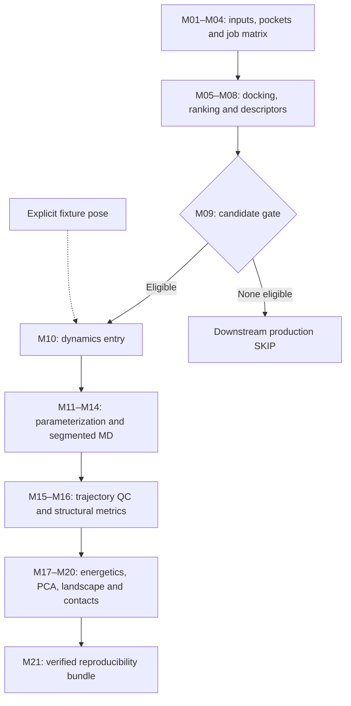

# PocketToDynamics: an auditable workflow from pocket-oriented virtual screening to molecular dynamics and empirical energy-landscape analysis

**Technical manuscript draft — 8 October 2026**  
**Software baseline:** commit `3de57df8a2980207111a8cb71d145eea0aecb382`, before publication-preparation changes.  
**Authors and affiliations:** to be supplied by the contributors.

## Abstract

PocketToDynamics is a modular computational workflow that connects pocket mapping and virtual screening to molecular dynamics (MD), structural analysis, endpoint energetic estimation, and empirical conformational landscapes. Its principal contribution is an explicit chain of job manifests, quality-control checks, and artifact provenance across otherwise separate computational tools. The implementation contains 25 executable entries spanning M01–M21, including screening preparation and dynamics-entry submodules. A candidate gate separates screening eligibility from downstream execution, while a deliberately selected fixture permits testing MD and analysis without representing a rejected ligand as a promoted scientific candidate. A recorded end-to-end audit using an adenylate-kinase/ethanol fixture reported 24 passing entries and one expected skip; the ordinary production route reported 12 passing entries and 13 skips because no candidate met the gate. The fixture included 20 ps each of NVT and NPT equilibration, 20 ps of segmented production, and 21 trajectory frames. Downstream checks covered structural metrics, three-frame MM/GBSA, principal component analysis, occupancy-derived landscapes, interaction persistence, and a hash-verified reproducibility archive. These observations establish limited software integration and data-consistency evidence, not binding affinity, conformational convergence, or biological activity. The workflow makes computational decisions and limitations inspectable while leaving scientific validation across realistic systems and longer simulations for future work.

**Keywords:** virtual screening; binding pockets; molecular dynamics; reproducibility; provenance; MM/GBSA; principal component analysis.

## 1. Introduction

A structure-based screening workflow involves more than generating docking scores. Pocket definitions must be connected to docking boxes, selected poses must preserve molecular identity when converted between formats, and parameterized systems must remain traceable through simulation and analysis. Each transition can introduce differences in atom ordering, chemical representation, reference coordinates, units, or sampling. A usable computational record must therefore describe both the numerical outputs and the decisions that produced them.

PocketToDynamics addresses these transitions through a sequence of independently inspectable Python modules coordinated by a common runner. It combines pocket-oriented docking with candidate selection, AMBER-based parameterization, GROMACS simulation [4], and trajectory analyses. The implementation emphasizes explicit failure states, artifact checksums, recorded commands, and separation between production eligibility and software fixtures. Docking and endpoint energetics are used as computational descriptors; neither is treated as an experimental affinity measurement.

This manuscript describes the inspected implementation and its recorded fixture validation. It does not report a screening campaign, a discovered ligand, an experimentally validated interaction, or a converged free-energy calculation. Earlier development descriptions ended at M14 with M15 under development. The repository inspected for this manuscript supersedes that milestone: M15–M21 contain executable implementations and recorded fixture checks. Their presence is distinguished below from the substantially broader scientific validation that remains outstanding.

## 2. Software Architecture and Workflow

The repository separates configuration, inputs, scripts, tests, manifests, logs, intermediate work, and results. Heavy simulation artifacts reside outside the source repository in configured dynamics directories. A canonical registry, `scripts/p2d_steps.py`, defines module order for both orchestration and status reporting. M05 and M10 each contain three executable entries, yielding 25 entries across M01–M21.

| Modules | Implemented responsibility | Evidence and scope |
|---|---|---|
| M01–M04 | Project initialization, input normalization, pocket mapping, deterministic job matrix | Recorded fixture and production-route passes |
| M05A–M05C | Engine preflight, input preparation, docking execution and provenance-aware reuse | Recorded docking fixture; not a comparative engine benchmark |
| M06–M09 | Score parsing, ranking, chemical descriptors, candidate gate | Recorded rejection of the ethanol fixture |
| M10A–M10C | Dynamics jobs, dependency preflight, selected-pose extraction | M10A expected skip; explicit fixture enters at M10C |
| M11–M14 | Parameterization, solvent/minimization, equilibration, segmented production | Recorded short computational fixture |
| M15 | Trajectory reconstruction, periodic-boundary processing and fitting | Implemented; recorded 21-frame fixture and subsequent artifact recheck |
| M16 | Structural metrics and protein–ligand contacts | Implemented; fixture and numerical checks |
| M17 | Single-trajectory MM/GBSA and residue decomposition | Implemented; three selected fixture frames |
| M18 | Cartesian C-alpha principal component analysis (PCA) | Implemented; covariance and reconstruction checks |
| M19 | PC1/PC2 occupancy landscape and representative structures | Implemented; discrete histogram checks |
| M20 | Per-residue contact and hydrogen-bond occupancy | Implemented; matrix/occupancy consistency checks |
| M21 | Inventory, source/environment snapshots, figures, tables and verified archive | Implemented; archive integrity checks |



*Figure 1. Logical workflow. The explicit fixture enters at M10C and does not change candidate eligibility. Each stage retains its own checks and provenance.*

The production and fixture routes have separate status tables and downstream output directories. `PASS` denotes satisfaction of module-specific software checks, whereas `SKIP` denotes absence of eligible upstream work. Neither status independently establishes scientific validity. The runner stops on nonzero exits or failed checks, initializes unexecuted entries as `NOT_RUN`, and records commands, durations, exit codes, and log hashes. Missing logs are represented as `UNKNOWN` rather than silently omitted.

The fixture is intentionally exceptional: the runner verifies the committed test input identities, exercises ordinary screening through M10B, and explicitly supplies the recorded ethanol pose at M10C. It does not reduce screening thresholds or relabel the ligand as a successful screening candidate. This permits downstream integration testing while retaining the meaning of the production gate.

## 3. Methods

### 3.1 Input preparation and pocket mapping

Input normalization and hashing establish identifiable receptor and ligand representations. M03 invokes ConCavity [6] and selects residues with scores of at least 0.10. Selected residues are connected when their C-alpha coordinates are within 8 Å; connected components containing at least three residues become pocket records. Components are ordered by summed score and then size. The arithmetic centroid of their C-alpha coordinates provides the pocket center. These are implementation thresholds, not experimentally calibrated definitions of ligandability.

M04 enumerates receptor–pocket–ligand combinations deterministically. Screening configuration specifies a 20 × 20 × 20 Å box and Vina as the default engine. The configured Vina settings are exhaustiveness 8, up to nine modes, an energy range of 4 kcal/mol, and seed 20261007. Meeko is the preferred preparation backend, with Open Babel available as a fallback. GNINA appears in engine configuration and preflight support, but the present evidence does not establish equivalent validation across engines. The Vina method is described by Eberhardt et al. [1].

Docking reuse requires agreement of inputs, docking box and parameters, task identity, executable contents/version, and the stored output-pose hash. Prior attempts are retained. This guards against accepting an old pose merely because an output file exists; it does not guarantee identical numerical results across arbitrary hardware and software environments.

### 3.2 Ranking and candidate eligibility

M06 extracts pose scores. M07 groups task-level best scores by receptor and ligand across mapped pockets, reporting the best, mean, median, standard deviation, worst score, hit fraction, and a gap between the two best pocket scores where available. Its integrated score combines dense ranks for best score, mean score, hit fraction, and score standard deviation, with equal configured weights. Score dispersion is a ranking heuristic across pockets; it is not replicate-based statistical uncertainty.

M08 calculates RDKit molecular descriptors and docking-derived ligand efficiency. The configured M09 gate requires all four conditions: integrated rank no greater than 20, best docking score no greater than −7.0 kcal/mol, hit fraction at least 0.25, and docking ligand efficiency at least 0.20. Numeric-domain checks reject nonfinite values, fractional ranks, and out-of-range fractions. The gate does not promote failed candidates. The thresholds describe the current configuration and have not been validated as predictors of affinity or biological response.

### 3.3 Selected-pose reconstruction and parameterization

M10 prepares dynamics job records, checks dependencies, and extracts the selected pose. Chemical identity is restored using the normalized SDF as the ligand reference while transferring docked heavy-atom coordinates. This addresses the loss of a chemically complete hydrogen representation in the docking PDBQT route. In the ethanol fixture, the resulting ligand has formula C2H6O and nine atoms.

M11 uses AmberTools `antechamber`, `parmchk2`, and `tleap`, with ff19SB for protein, GAFF2 for ligand, and AM1-BCC charges. ParmEd converts the resulting system to GROMACS representation. ff19SB is described by Tian et al. [2]. The configured solvent is TIP3P; this is the repository's tested configuration and should not be interpreted as a claim that it is the preferred solvent pairing for ff19SB. Crystallographic waters are stripped according to the configured residue-name policy. Consequently, the workflow does not currently establish retention of functionally essential crystallographic waters as a general preparation strategy.

### 3.4 System setup and simulation

M12 configures an octahedral TIP3P solvent box with a 12 Å buffer and neutralizes the system with sodium or chloride ions as required. Neutralization is distinct from prescribing a bulk electrolyte concentration. Steepest-descent minimization is configured for at most 5,000 steps, a 0.01 nm step size, and a force threshold of 1,000 kJ mol−1 nm−1. The configuration uses a Verlet cutoff scheme, particle-mesh Ewald electrostatics, and 1.0 nm real-space electrostatic and van der Waals cutoffs.

M13 performs 20 ps NVT and 20 ps NPT equilibration at 300 K and, for NPT, 1 bar. The timestep is 0.002 ps, hydrogen-involving bonds are constrained, and temperature and pressure coupling use V-rescale and C-rescale. These short configured stages are fixture-scale execution evidence; their adequacy for a new molecular system requires independent assessment.

M14 implements segmented production with checkpoint recovery. The ordinary production configuration specifies 100,000 ps total and 10,000 ps segments; these settings must not be confused with completed sampling. The fixture overrides them to 20 ps total in two 10 ps segments and writes coordinates every 1 ps. Reuse verifies source coordinates, checkpoint/topology provenance, configuration, executable signature, and completed-segment hashes. Legacy checkpoints without the required provenance are rejected.

### 3.5 Trajectory preprocessing and structural analysis

M15 generates whole, no-jump, centered, and backbone-fitted trajectory representations. It checks ordered segment intervals, hashes, atom counts, frame times, coordinates, boxes, and coverage. The ligand and protein are centered together, and the whole system is retained. MDAnalysis [5] reads GRO/XTC rather than the installed GROMACS TPR format, which is documented as unsupported by the installed MDAnalysis parser.

M16 computes protein and ligand root-mean-square deviation relative to the first frame after a common backbone fit. The ligand is not independently fitted. C-alpha root-mean-square fluctuation is measured about each atom's mean fitted position. Protein radius of gyration and solvent-accessible surface area are also reported. Heavy-atom contacts use a 0.45 nm cutoff and minimum-image distances on the unrotated centered trajectory. Protein–ligand hydrogen bonds are calculated with GROMACS `hbond-legacy` using a 0.35 nm donor–acceptor distance and a 30° deviation-from-linear angular cutoff. Metric timestamps must match the trajectory frames. Structural distances use nm, times ps, and surface areas nm².

### 3.6 Endpoint energetic estimates

M17 uses AmberTools `ante-MMPBSA.py` and `MMPBSA.py` [3] for single-trajectory MM/GBSA with `igb=5`, `mbondi2` radii, and the configured implicit-solvent salt concentration of 0.15 M. The implementation verifies Amber/GROMACS topology correspondence and atom identity before stripping solvent and ions. A rigid translation places the ligand in the nearest periodic image relative to the receptor, and an explicit frame ledger records selected frames and shifts.

The fixture selects frames 0, 10, and 20, corresponding to 0, 10, and 20 ps. Outputs include energy terms, residue decomposition, and the total endpoint estimate in kcal/mol. No entropy contribution is calculated. The reported ordinary standard error does not account for serial correlation and is not evidence of convergence. Numerical estimates are intentionally not presented as biological results in this manuscript.

### 3.7 Essential dynamics and empirical landscape

M18 performs unweighted Cartesian PCA on C-alpha coordinates from the common fitted trajectory. Coordinates are expressed in nm and centered about the sample mean. Singular-value decomposition yields eigenvalues using the N−1 covariance normalization; near-null singular modes are removed. Checks include reconstruction, orthogonality, mean-centered projections, and consistency of total projected variance. Configured frame limits are enforced explicitly instead of silently reducing the sample.

M19 bins the first two principal-component projections into an equal-width two-dimensional histogram: five bins per axis for the fixture and 30 for the ordinary configuration. For occupied bins, the reported relative landscape is

\[
F_i=-RT\ln(P_i/P_{\max}),
\]

where temperature is taken from the production manifest and R = 0.008314462618 kJ mol−1 K−1. Unsampled bins have infinite energy; no pseudocount is added. A deterministic eight-neighbor density-ascent procedure assigns discrete basins, retaining every basin. Representative frames are selected by proximity to the corresponding peak-bin center in PC1/PC2 space. This is an occupancy transformation of the sampled projection, not a demonstrated equilibrium free-energy surface or a validated kinetic-state model.

### 3.8 Interaction persistence and packaging

M20 calculates per-residue heavy-atom contact occupancy as the fraction of sampled frames with a contact. Hydrogen bonds use topology-derived donor–hydrogen bonds and MDAnalysis charge-based hydrogen/acceptor heuristics, with a donor–acceptor cutoff of 3.5 Å and a donor–hydrogen–acceptor angle greater than 150°. This definition is recorded separately from the M16 GROMACS convention; identical counts are not assumed. Residues are ranked by contact occupancy and then hydrogen-bond occupancy. Persistence denotes sampled-frame frequency, not residence time.

M21 assembles source snapshots, configuration, inputs, simulation artifacts, environment descriptions, commands, figures, and tables into an archive with an inventory and SHA-256 hashes. Archive members are read back and verified after compression, and a verification script supports checking the extracted bundle. External binaries and complete Conda environments are described rather than embedded. The source Git repository and the heavy reproducibility bundle are separate distribution objects.

## 4. Validation and Testing

Evidence has three levels: source inspection establishes implementation; saved manifests, logs, and artifacts establish recorded execution; regression and numerical checks establish selected invariants. None alone establishes scientific predictive performance. The recorded audit is documented in `docs/AUDIT_2026-10-08.md`, the two status tables, and the production/fixture audit manifests.

The ordinary route with test inputs passed screening and candidate evaluation but promoted no ligand. Dynamics stages dependent on a promoted job therefore skipped. The explicit fixture continued from its controlled pose and exercised parameterization through archive construction. During the recorded audit, M17 initially encountered an Amber topology-overwrite failure. The implementation was corrected, the prior attempt retained, and the audit resumed after checking upstream records. This history demonstrates a recorded recovery path rather than an uninterrupted first-attempt execution.

Negative regression checks cover altered hashes, incompatible docking reuse, malformed manifests, nonfinite candidate values, invalid ranks/fractions, corrupted production outputs, and trajectory gaps. M14 also has checkpoint-resume integration checks. Module-level tests verify dimensions, units and ranges where applicable, initial RMSD, selected energetic frames, PCA invariants, landscape frame accounting, occupancy consistency, and bundle inventory contents.

During publication preparation, the core integrity and pipeline-failure regression suites passed again. Read-only checks of existing M15–M21 artifacts also passed. These checks did not regenerate trajectories or repeat the full computational audit. They therefore provide fresh verification of selected existing artifacts, not a new independent MD replicate or a new end-to-end run.

## 5. Results of Fixture Validation

The receptor fixture identifies adenylate kinase as PDB entry 4AKE and contains two 214-residue chains. Ethanol is a small integration-test ligand. Its use does not imply known or predicted specific binding to adenylate kinase.

| Check | Recorded observation | Interpretation |
|---|---|---|
| Production-route status | 12 PASS, 13 SKIP | Correct downstream abstention after candidate rejection |
| Explicit fixture status | 24 PASS, 1 SKIP | M10A remained an expected skip; controlled M10C entry exercised downstream software |
| Ligand reconstruction | C2H6O; nine atoms | Chemical representation preserved for this fixture |
| Solvated system | 64,587 atoms; reported residual charge below 10−6 elementary-charge units | Setup and charge consistency for one system |
| Minimization | Recorded convergence | Numerical minimization criterion satisfied |
| Equilibration | 20 ps NVT and 20 ps NPT | Short execution and configured QC completed |
| Production | 20 ps in two segments | Segmentation, completion detection and checkpoint recovery exercised |
| Preprocessed trajectory | 21 frames; 0–20 ps; 1 ps spacing | Expected frame/coverage integrity |
| Structural analysis | Initial RMSD zero; positive SASA/Rg; 428 C-alpha RMSF entries | Numerical and selection consistency |
| MM/GBSA | Three frames at 0, 10 and 20 ps; residue decomposition generated | Endpoint-estimation pipeline executed |
| PCA | 21 observations; rank 20 | Sample-limited covariance decomposition and reconstruction checks |
| Landscape | Three histogram basins; all 21 frames assigned | Complete discrete occupancy accounting |
| Interaction analysis | 21 × 428 residue-contact matrix | Frame/residue alignment and bounded occupancies |
| Reproducibility archive | Inventory and archived contents hash-verified | Integrity of the recorded package |

The rank-20 PCA is consistent with at most N−1 nonzero dimensions for 21 centered observations; it is not evidence of a 20-dimensional physical mechanism. Likewise, three histogram basins in a five-by-five grid describe the particular short sample and binning, not three established molecular states. Zero contacts or hydrogen bonds are permitted observations and are not automatically treated as software errors.

## 6. Reproducibility

The repository provides YAML configuration, an environment specification, executable modules, tests, and lightweight audit records. The documented stack includes Python 3.11, GROMACS 2026.3, AmberTools 25/MMPBSA.py 14.0, MDAnalysis 2.10.0, RDKit, NumPy, SciPy, ParmEd, and Matplotlib. Some dependencies are pinned while others are not; the environment file is not a complete immutable lockfile. Recorded runtime versions and the bundle's environment snapshot are therefore important complements.

After installing dependencies and configuring executable/output paths, the documented runner commands are:

```bash
bash scripts/run_pipeline.sh --profile production
bash scripts/run_pipeline.sh --profile fixture
```

The fixture command requires the exact committed test inputs in the expected input directories. It does not replace arbitrary user inputs. Because the production configuration includes long-duration settings, operators must review configuration before launching calculations. The configured home-directory and external-disk paths also require explicit adaptation on another machine. Reproduction in a clean independent environment has not been established by the evidence reported here.

Checksums document identity and detect unintended changes; they do not establish scientific correctness. Resume guards reduce accidental reuse across changed computational conditions, while attempt histories preserve failed runs for inspection. Git stores source, small fixtures and lightweight documentation; heavy trajectories, checkpoints, environments, credentials and local sensitive material are excluded from the publication repository. Reproducing the numerical fixture requires either locally regenerating its heavy artifacts or separately obtaining an appropriate archived bundle.

## 7. Limitations

Validation currently centers on one receptor/ligand fixture and short trajectories. There is no demonstrated screening enrichment, pose-recovery benchmark, affinity correlation, comparative performance study, replicate convergence analysis, or experimental validation. The candidate gate prevented a real promoted-candidate production run in the recorded audit. Support for configuration options or alternative engines must not be interpreted as validation of all combinations.

Preparation choices, protonation states, retained waters, ion composition, force-field/solvent compatibility, and sampling duration require system-specific scientific judgment. The configured TIP3P/ff19SB combination was exercised computationally but has not been compared with alternatives here. Pocket score thresholds, clustering distances, ranking weights and candidate cutoffs are heuristics whose general performance remains unmeasured.

MM/GBSA omits entropy and uses sparse, potentially correlated frames. The empirical landscape depends strongly on sampling, projection and bin width. PCA does not validate reaction coordinates, and contact frequency does not establish binding stability or residence time. Hydrogen-bond heuristics differ between analysis modules. Runtime paths are partly installation-specific, and the current environment specification does not guarantee portable, bitwise reproduction.

## 8. Availability

The development repository is [BioinformaticaUDESC/PocketToDynamics](https://github.com/BioinformaticaUDESC/PocketToDynamics). At manuscript preparation it is private; access depends on repository-owner authorization. No public software release, archival DOI, or software license has been established. The inspected baseline is identified above, and publication-preparation changes are recorded in subsequent commits. Heavy simulation artifacts and reproducibility archives are not included in the source publication. Public release terms, an archival deposit, and a durable data-access statement remain to be established before journal submission.

## 9. Discussion

The evidence supports PocketToDynamics as a working integration prototype with explicit provenance and fail/skip semantics. Its distinction between a rejected screening candidate and an authorized software fixture is particularly useful: analysis tools can be tested without creating the appearance of scientific candidate success. Hash checks and restart guards also make computational reuse a recorded decision rather than a consequence of file presence.

The workflow's breadth should nevertheless be interpreted separately from the depth of validation. Connecting docking, MD, endpoint energetics and PCA does not make their outputs mutually confirming evidence of affinity. Each method introduces assumptions, and downstream processing cannot repair insufficient sampling or unsuitable preparation. The fixture is valuable because it exposes format, topology, frame-selection and packaging errors; it is inadequate for judging biological performance.

M01–M14 are implemented, and M15–M21 are also implemented and fixture-checked in the inspected repository. They should therefore not be listed as merely planned modules or described as M15 still being under development. Future work concerns broader validation and engineering hardening: independent clean-environment reproduction, richer molecular fixtures, benchmarking against reference datasets, replicated sampling, uncertainty analysis, sensitivity to landscape binning, and more portable configuration. These are proposed extensions, not completed results or claims that additional numbered modules already exist.

## 10. Conclusion

PocketToDynamics implements an inspectable computational chain from pocket-oriented screening to MD and empirical landscape analysis. Its recorded fixture demonstrates software interoperability, conditional execution, trajectory and topology consistency, and archive integrity across M01–M21. The corresponding production route appropriately abstained from dynamics when no ligand passed screening criteria. The current evidence supports a technical workflow report and a foundation for broader validation; it does not support claims of ligand efficacy, binding affinity, thermodynamic convergence, or experimentally established molecular mechanisms.

## References

1. Eberhardt J, Santos-Martins D, Tillack AF, Forli S. AutoDock Vina 1.2.0: New Docking Methods, Expanded Force Field, and Python Bindings. *Journal of Chemical Information and Modeling*. 2021. [doi:10.1021/acs.jcim.1c00203](https://doi.org/10.1021/acs.jcim.1c00203).
2. Tian C, et al. ff19SB: Amino-Acid-Specific Protein Backbone Parameters Trained against Quantum Mechanics Energy Surfaces in Solution. *Journal of Chemical Theory and Computation*. 2020. [doi:10.1021/acs.jctc.9b00591](https://doi.org/10.1021/acs.jctc.9b00591).
3. Miller BR III, et al. MMPBSA.py: An Efficient Program for End-State Free Energy Calculations. *Journal of Chemical Theory and Computation*. 2012. [doi:10.1021/ct300418h](https://doi.org/10.1021/ct300418h).
4. Abraham MJ, et al. GROMACS: High performance molecular simulations through multi-level parallelism from laptops to supercomputers. *SoftwareX*. 2015. [doi:10.1016/j.softx.2015.06.001](https://doi.org/10.1016/j.softx.2015.06.001).
5. Michaud-Agrawal N, et al. MDAnalysis: A Toolkit for the Analysis of Molecular Dynamics Simulations. *Journal of Computational Chemistry*. 2011. [doi:10.1002/jcc.21787](https://doi.org/10.1002/jcc.21787).
6. Capra JA, et al. Predicting Protein Ligand Binding Sites by Combining Evolutionary Sequence Conservation and 3D Structure. *PLOS Computational Biology*. 2009. [doi:10.1371/journal.pcbi.1000585](https://doi.org/10.1371/journal.pcbi.1000585).

The accompanying `manuscript_evidence.md` maps implementation and validation claims to repository records. Bibliographic coverage should be completed for all third-party methods and software, and author contributions, funding, competing interests and release terms supplied, before journal submission.
